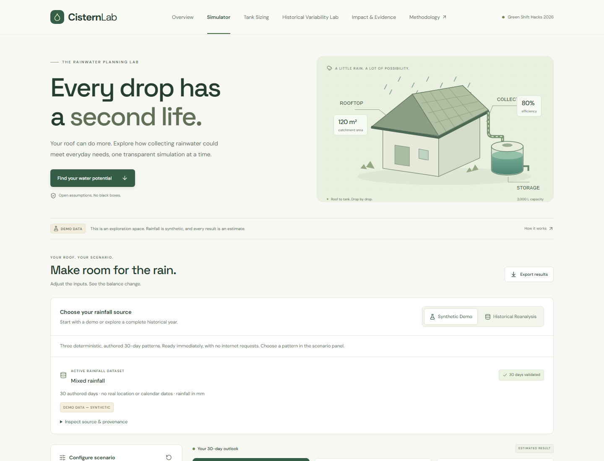
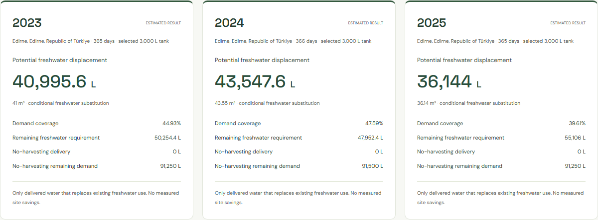

# CisternLab

_Every drop has a second life._

[Live application](https://hizmali.github.io/CisternLab/) · [Source code](https://github.com/HIZMALI/CisternLab) · [CI and deployment](https://github.com/HIZMALI/CisternLab/actions/workflows/deploy.yml) · [Demo guide](docs/DEMO_GUIDE.md)

## Overview

CisternLab helps schools, households and small facilities explore rooftop rainwater harvesting for non-potable demand. Adjust a scenario, inspect every daily liter, compare tank capacities and trace conditional freshwater displacement estimates to their rainfall source.

It runs entirely in the browser, with no backend, account, API key or paid API. Synthetic examples are labeled **DEMO DATA — SYNTHETIC**; historical sources are labeled **ERA5 reanalysis**. All calculated results are **ESTIMATED RESULTS**, not measured site savings.

## The Problem

Rain arriving in bursts can overflow a tank while demand on later dry days goes unmet. Annual rainfall totals alone cannot show how much useful water a particular tank might deliver. People considering irrigation, cleaning or toilet-flushing demand need to compare rainfall timing, storage and usage together.

## The Solution

CisternLab combines a transparent daily water balance with capacity comparisons and inspectable source records. It helps users explore assumptions before considering a physical system, while keeping limitations and the conditions behind environmental estimates visible.

## Live Demo

Open **[CisternLab](https://hizmali.github.io/CisternLab/)**:

1. Try the default synthetic simulator and change roof, capacity or demand.
2. Open **Tank Sizing** to compare tested capacities and the adjustable yield target.
3. In **Impact & Evidence**, wait for **Archive verified**, then choose **Explore Archived Edirne Example**. It uses preserved data without a weather request.
4. Inspect annual comparisons and provenance, complete **Explore the Evidence**, copy findings or **Print / Save Evidence Brief**.
5. For fresh data, select **Historical Reanalysis**, search a city, explicitly select a location/year and load rainfall. Then use **Historical Variability Lab → Load three-year comparison**.

See the [demo guide](docs/DEMO_GUIDE.md) for the full walkthrough, gallery and [printable example](docs/evidence/edirne-impact-brief.pdf).



## Key Features

- Interactive roof area, efficiency, tank capacity, fixed daily demand and initial-storage controls, with illustrative home/school/facility presets.
- Three deterministic synthetic rainfall patterns and complete 2023, 2024 or 2025 ERA5 calendar years from Open-Meteo.
- Daily storage/balance charts, overflow, delivery, unmet demand, coverage and a complete accessible table.
- Tank Sizing & Decision Lab with tested-capacity comparisons, transparent recommendations, signed differences and marginal yields.
- Historical Variability Lab with three independent years, annual/cross-year decisions, shortage counts/streaks and source validation.
- Impact & Evidence Studio comparing no harvesting, current, recommended and selected capacities, with conditional annual/three-year estimates.
- Verified archived Edirne data, original-source download, a keyboard-operable walkthrough, copyable findings and an A4 evidence brief.
- Daily/sizing/comparison CSV and reproducibility JSON exports with original rainfall, units, assumptions and provenance.
- Responsive navigation, semantic controls, chart-equivalent tables and keyboard scrolling. Fonts are bundled locally.

## How It Works

Choose authored synthetic rain, an explicitly selected historical city/year, or the archived example. Only validated rainfall becomes active. Physical-input edits recalculate locally; they do not download weather again. Historical failures leave the labeled prior dataset intact and offer manual retry.

Sizing candidates start empty. Historical comparisons start empty independently each January, with no December-to-January carryover. The dashboard's initial storage is separate. The archived example remains usable on the open page after its assets are prepared, including offline; first-ever offline access and offline reload are not supported.

## Technology Stack

React · strict TypeScript · Vite · Tailwind CSS · Lucide · Recharts · Vitest · Playwright · axe. GitHub Actions runs the quality gates and deploys the static `dist` bundle to GitHub Pages.

## Data Sources

Weather data by [Open-Meteo](https://open-meteo.com/) using [ERA5 / Copernicus C3S](https://cds.climate.copernicus.eu/datasets/reanalysis-era5-single-levels); location search by [GeoNames](https://www.geonames.org/). Requests explicitly use `models=era5`, daily `rain_sum` and millimeters. `precipitation_sum` is not substituted.

ERA5 is gridded modeled reanalysis, not station or rooftop measurements. Complete ordered calendars and finite nonnegative rain values are required; missing/invalid data is rejected rather than filled. Selected and returned grid coordinates, original requests, retrieval timestamps, timezone/fixed offset, model/units and dates remain inspectable and exported. Daily aggregation does not reconstruct historical DST transitions. Future API responses can be revised.

The [original Edirne snapshot](docs/data/edirne-era5-2023-2025.snapshot.json) preserves **1,096 records**: 365 in 2023, 366 in 2024 and 365 in 2025. It was retrieved on **23 October 2026**. Its identical browser copy is checked against SHA-256:

```text
2aee94b5a369acf8164bbb1e9d7265c8b89f5eba0a2a8719fe4a132c5e7197d7
```

Synthetic sequences in `src/data/demo.ts` are fixed 30-day illustrations without real locations, dates or climate probabilities. See [data provenance](docs/DATA_PROVENANCE.md) for request/validation details, original metadata, privacy and reproduction.

## Scientific Methodology

The deterministic **rain-before-demand** model first collects rain, then spills excess water, then serves daily demand. For roof `A` (m²), rain `P[t]` (mm), efficiency `e`, capacity `C` (L), demand `D` (L/day) and storage `S` (L):

```text
Incoming I[t]    = A × P[t] × e
Available V[t]   = S[t−1] + I[t]
Overflow O[t]    = max(0, V[t] − C)
Retained R[t]    = min(C, V[t])
Delivered U[t]   = min(D, R[t])
End storage S[t] = R[t] − U[t]
Unmet M[t]       = D − U[t]
```

One mm over one m² equals one liter before collection losses. Daily and period conservation are enforced:

```text
Opening storage + incoming = overflow + delivered + end storage
Demand = delivered + unmet
Initial storage + Σ incoming = Σ overflow + Σ delivered + final storage
```

The model has no sub-daily precision. It validates inputs and accounts for floating-point tolerance while retaining full calculation precision.

The **recommended tested capacity** is the smallest positive standard candidate reaching the selected fraction (80%, 90%, 95% or 98%) of maximum delivery among tested standard capacities. Every candidate starts at 0 L. The three-year comparison must satisfy each annual target independently. Zero usable supply has no meaningful recommendation; zero-demand coverage is undefined.

This is a transparent decision heuristic over a finite candidate set, not a universal optimum, financial recommendation or certified engineering rule. [Detailed methodology and scientific references](docs/METHODOLOGY.md) document the candidates, tolerances, marginal yields, annual boundaries and limitations.

## Environmental Impact Example

Using archived Edirne rainfall, a **120 m²** roof, **80%** collection efficiency, **250 L/day** demand and independent empty annual starts:

| Period                   | Delivery with 2,000 L tank | Delivery with 3,000 L tank |
| ------------------------ | -------------------------: | -------------------------: |
| 2023                     |                 39,030.8 L |                 40,995.6 L |
| 2024                     |                 41,299.2 L |                 43,547.6 L |
| 2025                     |                 34,261.6 L |                   36,144 L |
| Sum of independent years |            **114,591.6 L** |            **120,687.2 L** |

The modeled increment is **6,095.6 L** across these years. The 90% tested-yield heuristic selects 3,000 L for this comparison.

**Potential freshwater displacement equals delivered rainwater ONLY IF it replaces an otherwise used liter of freshwater.** These are conditional estimates for assumed inputs, not measured savings at an Edirne property. Unused ending storage is excluded. The three-year total is neither an annual figure nor a continuous multiyear tank run. Overflow changes do not establish real runoff or flood-risk reduction.



## Installation

Use Node.js **24** and npm:

```sh
git clone https://github.com/HIZMALI/CisternLab.git
cd CisternLab
npm ci
npm run dev
```

Open `http://127.0.0.1:4317/`. To preview the production subpath:

```sh
npm run build
npm run preview -- --host 127.0.0.1 --port 4173 --strictPort
```

Open `http://127.0.0.1:4173/CisternLab/`. Vite keeps development at `/` and build/preview at `/CisternLab/`. Hash navigation works without a history-router fallback. A fork using another repository name must update the Vite base, Playwright URL and publication links.

## Running Tests

```sh
npm run typecheck
npm run lint
npm test
npm run build
npm run format:check
npx playwright install chromium
npm run test:e2e
git diff --check
```

The suite retains **242 unit tests and 68 browser tests**, including numerical references, mass conservation, calendar/provenance validation, archived integrity, exports, errors, keyboard controls and print. Browser checks cover 1440, 768, 390 and 320 px and WCAG 2.1 A/AA rules through axe; automated checks are not full accessibility certification. Deterministic historical tests use explicitly synthetic transport fixtures rather than live-service uptime. The archived tests use actual preserved bytes.

Playwright owns its port-4173 production preview and writes temporary evidence to ignored `test-results/`. `npx playwright show-report` opens the ignored HTML report. Optional `npm run verify:production` checks the real HTTPS app with actual Open-Meteo requests and writes ignored evidence to `artifacts/`; this can fail when external services are unavailable. Local annual and three-year live checks are available as `npm run verify:live` and `npm run verify:historical-live`.

The [deployment workflow](.github/workflows/deploy.yml) runs Node.js 24, `npm ci`, all listed quality gates and Chromium with Linux dependencies before publishing. It supports push-to-main and manual dispatch. In GitHub Settings → Pages choose GitHub Actions; no personal deployment token is needed.

## Reproducibility

Keep original rainfall and metadata alongside physical inputs, target/candidate set and actual period. Download the archived snapshot, daily/sizing CSV, or historical comparison JSON. Calculations use raw rainfall rather than saved precomputed result tables. Identical inputs and rainfall produce identical outputs, while a future API request may return revised source data.

The [provenance guide](docs/DATA_PROVENANCE.md) includes checksum commands and pure-function reproduction. The [methodology](docs/METHODOLOGY.md) explains all equations and decision assumptions. The [demo guide](docs/DEMO_GUIDE.md) links five curated product screenshots and the evidence brief.

## Limitations

- Daily timing, fixed demand/efficiency and independent empty starts simplify real systems. No first-flush, evaporation, leakage, treatment, pump, drainage or installation model is included.
- ERA5 is spatially averaged modeled rain; three years cannot establish a long-term climate normal, trend, guaranteed reliability or site-specific optimum.
- Tested capacities and relative-yield targets are project choices, not verified products or design standards. Synthetic results are not annualized.
- No measured site savings, carbon/financial benefit, water-quality guarantee, climate forecast or certified engineering outcome is claimed. Installation, actual use and applicable regulations require separate assessment.
- Live API availability, CORS, rate limits and revisions are external. Prepared same-page archived use works offline; persistent/offline reload caching is absent.
- UI values round; exports retain precision. Chromium and the listed widths are tested; other browsers, screen readers and physical touch hardware need further human review.

## License and Attribution

Original CisternLab code and documentation are [MIT licensed](LICENSE). Third-party data, fonts, icons and dependencies retain their own licenses; see [THIRD_PARTY_NOTICES.md](THIRD_PARTY_NOTICES.md) and the bundled [license texts](public/licenses/THIRD-PARTY-SOFTWARE.txt).

Open-Meteo API data uses [CC BY 4.0](https://creativecommons.org/licenses/by/4.0/) with [attribution and transformation notices](https://open-meteo.com/en/licence). Weather credits identify Open-Meteo, ERA5/Copernicus C3S and GeoNames throughout the application and exports. Original rain is preserved; CisternLab derives estimated tank volumes without provider endorsement. The public free API service is non-commercial under its [terms](https://open-meteo.com/en/terms); MIT does not grant commercial service access. DM Sans and Space Grotesk retain their included SIL OFL licenses.
